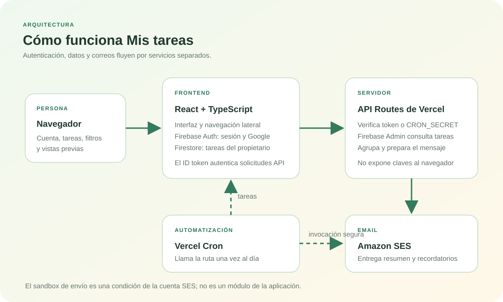

# Mis tareas

Aplicación web para organizar tareas personales, controlar fechas de entrega y recibir resúmenes y recordatorios por correo. Está construida con React y TypeScript; Firebase gestiona el acceso y los datos, las funciones de Vercel conectan la aplicación con Amazon SES.

## Índice

- [Qué es la aplicación](#qué-es-la-aplicación)
- [Flujo de la aplicación](#flujo-de-la-aplicación)
- [Funciones principales](#funciones-principales)
- [Tecnologías y estructura](#tecnologías-y-estructura)
- [Instalación y ejecución local](#instalación-y-ejecución-local)
- [Configuración de Firebase](#configuración-de-firebase)
- [Correo, Amazon SES y modo sandbox](#correo-amazon-ses-y-modo-sandbox)
- [Recordatorios programados](#recordatorios-programados)
- [Variables de entorno](#variables-de-entorno)
- [Comandos disponibles](#comandos-disponibles)
- [Cambios recientes](#cambios-recientes)
- [Uso de inteligencia artificial](#uso-de-inteligencia-artificial)

## Qué es la aplicación

**Mis tareas** permite crear una cuenta, iniciar sesión y mantener una lista privada de tareas. Cada tarea puede incluir descripción, prioridad y fecha límite; al especificar también la hora, se puede activar un recordatorio por correo. La persona puede consultar tareas pendientes o completadas, editarlas, marcarlas como completadas y eliminarlas.

La aplicación también ofrece un resumen por correo. Al ingresar, muestra un aviso de tareas pendientes próximas o un mensaje de bienvenida si no hay tareas pendientes.

[↑ Volver al índice](#índice)

## Flujo de la aplicación



1. La persona crea una cuenta con correo y contraseña, o accede con Google. Firebase Authentication administra la sesión y la verificación del correo.
2. La interfaz consulta y modifica en Firestore únicamente las tareas cuyo `userId` corresponde a la cuenta activa. Las reglas de Firestore validan la propiedad en cada operación.
3. Para enviar el resumen, el frontend entrega el token de Firebase a `POST /api/send-summary`. El servidor valida la sesión, recupera las tareas de esa persona y solicita el envío a SES.
4. Para los recordatorios, el cron de Vercel llama `GET /api/send-reminders` con `CRON_SECRET`. La API agrupa por propietario las tareas que cumplen las condiciones y envía el correo una vez por tarea.

Puedes reemplazar `flujo-aplicacion.svg` por otra imagen conservando el nombre, o cambiar la ruta del enlace de imagen en este apartado.

[↑ Volver al índice](#índice)

## Funciones principales

| Opción | Qué permite hacer |
| --- | --- |
| Crear cuenta / Iniciar sesión | Acceder con correo y contraseña; el registro solicita verificar el correo. |
| Continuar con Google | Autenticarse con Google si el proveedor está habilitado en Firebase Authentication. |
| Agregar tarea | Guardar título y descripción, elegir prioridad (urgente, pasable o normal) y definir una fecha límite opcional. |
| Fecha y hora | Elegir hoy, mañana o una fecha personalizada. La hora es opcional; los recordatorios por correo requieren una fecha y hora. |
| Todas, pendientes y completadas | Cambiar el filtro de la lista y consultar el conteo por estado. Las tareas completadas se muestran tachadas. |
| Editar / Eliminar | Actualizar la tarea o confirmar su eliminación. |
| Aviso al entrar | Mostrar tareas próximas y tareas sin fecha, o una bienvenida si no hay tareas pendientes. |
| Resumen por correo | Abrir una vista previa o solicitar un resumen actualizado al correo de la cuenta. |
| Notificaciones | Consultar el apartado y la vista previa de recordatorios. |
| Cerrar sesión | Terminar la sesión de Firebase en el dispositivo actual. |

Los correos dependen de la configuración y el estado de Amazon SES. Revisa Recibidos, Promociones y Spam.

[↑ Volver al índice](#índice)

## Tecnologías y estructura

- **Frontend:** React, TypeScript, Vite y CSS.
- **Autenticación y datos:** Firebase Authentication y Cloud Firestore.
- **Backend:** rutas de API en Vercel con Firebase Admin SDK.
- **Correo:** Amazon Simple Email Service (SES), con AWS SDK para JavaScript.
- **Calidad:** Vitest y Testing Library para pruebas; Oxlint para análisis estático.

```text
api/
  send-summary.ts       # API autenticada para enviar el resumen
  send-reminders.ts     # API protegida invocada por el cron
src/
  components/           # Lista, resumen, notificaciones y pie de página
  services/             # Inicialización de Firebase y operaciones de tareas
  types/                # Tipos de tareas y prioridades
  App.tsx               # Autenticación, navegación y flujo principal
  App.css               # Estilos de la interfaz
firestore.rules         # Acceso a tareas limitado a su propietario
vercel.json             # Programación diaria de recordatorios
.env.example            # Plantilla de variables sin valores secretos
IA.md                   # Registro detallado del apoyo de IA
flujo-aplicacion.svg    # Diagrama del flujo de la aplicación
```

[↑ Volver al índice](#índice)

## Instalación y ejecución local

Necesitas Node.js y npm. Ejecuta los comandos en la carpeta que contiene `package.json`:

```powershell
npm install
if (-not (Test-Path .env.local)) { Copy-Item .env.example .env.local }
npm run dev
```

Completa `.env.local` con la configuración de Firebase y las variables requeridas por las funciones de servidor. No publiques este archivo ni incluyas credenciales en Git. `npm run dev` inicia la interfaz con Vite; las rutas `/api` y el cron se ejecutan en Vercel, así que Vite por sí solo no reproduce los envíos de correo del despliegue.

Para publicar, conecta el repositorio con Vercel y configura allí las variables de entorno. Los cambios en variables requieren un nuevo despliegue.

[↑ Volver al índice](#índice)

## Configuración de Firebase

1. Crea o selecciona un proyecto Firebase y registra una aplicación web.
2. Habilita **Correo electrónico/contraseña** y **Google** en Authentication.
3. Añade los dominios de desarrollo y producción a los dominios autorizados de Authentication.
4. Crea Firestore y publica las reglas de [firestore.rules](firestore.rules).
5. Crea una cuenta de servicio para Firebase Admin y guarda su JSON en `FIREBASE_ADMIN_SERVICE_ACCOUNT` como variable privada de Vercel.

Las reglas restringen la lectura, escritura y eliminación de tareas al UID autenticado y validan los campos principales, incluidos prioridad, fecha y recordatorio.

[↑ Volver al índice](#índice)

## Correo, Amazon SES y modo sandbox

La aplicación no contiene una función propia llamada `sandbox`. **El modo sandbox pertenece a la cuenta de Amazon SES en una región específica** y limita a quién se puede enviar correo. Mientras SES esté en sandbox, se debe verificar el remitente y también cada destinatario, con las excepciones de prueba admitidas por AWS. Verificar la cuenta en Firebase no verifica al destinatario ante SES.

El código usa `SESv2Client` y `SendEmailCommand` en las rutas del servidor. Las credenciales AWS permanecen en variables privadas, nunca llevan prefijo `VITE_` y no se exponen al navegador. La identidad IAM necesita permisos para enviar con SES.

Para enviar a destinatarios reales sin verificarlos uno por uno, hay que solicitar a AWS salir del sandbox en la región que usa la aplicación y esperar la aprobación. El remitente debe seguir verificado. Consulta la [documentación oficial de AWS para solicitar acceso de producción](https://docs.aws.amazon.com/ses/latest/dg/request-production-access.html) y la [guía de envío de SES](https://docs.aws.amazon.com/ses/latest/dg/send-email.html).

La solicitud se puede iniciar desde CloudShell con AWS CLI. Este comando **solicita** acceso; no lo aprueba automáticamente:

```bash
aws sesv2 put-account-details \
  --region us-east-2 \
  --production-access-enabled \
  --mail-type TRANSACTIONAL \
  --website-url https://tu-app.vercel.app \
  --additional-contact-email-addresses contacto@ejemplo.com \
  --contact-language EN
```

Consulta el estado de SES en esa región con:

```bash
aws sesv2 get-account --region us-east-2
```

Revisa `ProductionAccessEnabled` y `SendingEnabled` en la respuesta. La autorización es regional; una aprobación en otra región no cambia `us-east-2`.

[↑ Volver al índice](#índice)

## Recordatorios programados

`vercel.json` programa `/api/send-reminders` diariamente a las 12:00 UTC (`0 12 * * *`). La ruta exige `CRON_SECRET`, consulta tareas elegibles en Firestore, verifica que sigan pendientes y que el correo del propietario esté verificado, y envía el mensaje mediante SES. Tras enviarlo, marca las tareas para evitar repetir el recordatorio.

El recordatorio se calcula aproximadamente 48 horas antes de la fecha límite, pero el cron se ejecuta una vez al día: no es un aviso exacto al minuto. En el plan Hobby de Vercel, la ejecución tiene precisión por hora y puede variar hasta 59 minutos. Configura `CRON_SECRET` en Vercel y no llames esta ruta desde el navegador. Consulta los [límites actuales de Cron Jobs de Vercel](https://vercel.com/docs/cron-jobs/usage-and-pricing).

[↑ Volver al índice](#índice)

## Variables de entorno

| Variable | Uso | Dónde configurarla |
| --- | --- | --- |
| `VITE_FIREBASE_API_KEY` | Configuración de la app web de Firebase. | `.env.local` y Vercel. |
| `VITE_FIREBASE_AUTH_DOMAIN` | Dominio de Authentication. | `.env.local` y Vercel. |
| `VITE_FIREBASE_PROJECT_ID` | Identificador del proyecto Firebase. | `.env.local` y Vercel. |
| `VITE_FIREBASE_STORAGE_BUCKET` | Bucket asociado al proyecto. | `.env.local` y Vercel. |
| `VITE_FIREBASE_MESSAGING_SENDER_ID` | Identificador de mensajería Firebase. | `.env.local` y Vercel. |
| `VITE_FIREBASE_APP_ID` | Identificador de la aplicación web. | `.env.local` y Vercel. |
| `AWS_REGION` | Región de SES, por ejemplo `us-east-2`. | Solo servidor / Vercel. |
| `AWS_ACCESS_KEY_ID` | Identificador de la credencial IAM. | Solo servidor / Vercel. |
| `AWS_SECRET_ACCESS_KEY` | Secreto de la credencial IAM. | Solo servidor / Vercel. |
| `SES_FROM_EMAIL` | Dirección remitente verificada en SES. | Solo servidor / Vercel. |
| `FIREBASE_ADMIN_SERVICE_ACCOUNT` | JSON de Firebase Admin. | Solo servidor / Vercel. |
| `CRON_SECRET` | Protege la ejecución del cron de recordatorios. | Vercel. |

`.env.example` contiene los nombres esperados sin secretos. No subas `.env.local`, claves AWS, el JSON de Firebase Admin ni `CRON_SECRET` al repositorio.

[↑ Volver al índice](#índice)

## Comandos disponibles

```bash
npm run dev       # inicia Vite en desarrollo
npm run build     # verifica TypeScript y genera la compilación
npm run preview   # sirve localmente la compilación de Vite
npm run lint      # ejecuta Oxlint
npm test          # ejecuta Vitest una vez
```

[↑ Volver al índice](#índice)

## Cambios recientes

- Se añadieron prioridades **urgente**, **pasable** y **normal**.
- El formulario permite elegir fecha límite y hora por separado; la hora puede quedar sin definir.
- La navegación lateral reúne las vistas de tareas, resumen y notificaciones.
- La lista separa tareas pendientes y completadas; solo las completadas aparecen tachadas.
- Al iniciar sesión, se presenta un aviso con tareas pendientes próximas —incluidas las que no tienen hora— o una bienvenida cuando no hay pendientes.
- Se puede abrir una vista previa del resumen y del recordatorio antes de usarlos.
- Los correos de resumen y recordatorio incluyen versiones HTML y texto.
- Las reglas de Firestore validan prioridad, fecha y recordatorio, y restringen las tareas a su propietario.
- Se incorporaron pruebas de componentes de tareas, resumen y servicios.
- Vercel procesa recordatorios pendientes mediante una tarea programada diaria.

[↑ Volver al índice](#índice)

## Uso de inteligencia artificial

Se utilizaron **ChatGPT** y **Gemini** como apoyo para investigar errores, revisar alternativas de código, mejorar textos y preparar documentación. Las decisiones, la configuración de servicios, las pruebas y los ajustes finales también fueron revisados y realizados manualmente durante el desarrollo.

En [IA.md](IA.md) se detallan ejemplos reconstruidos de prompts, respuestas, fragmentos de código, errores y aprendizajes. Son ejemplos ilustrativos, no transcripciones literales del historial.

[↑ Volver al índice](#índice)
